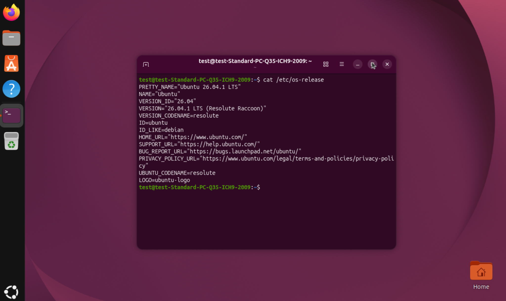
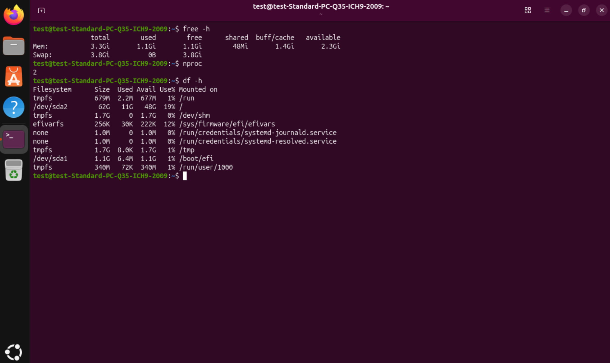
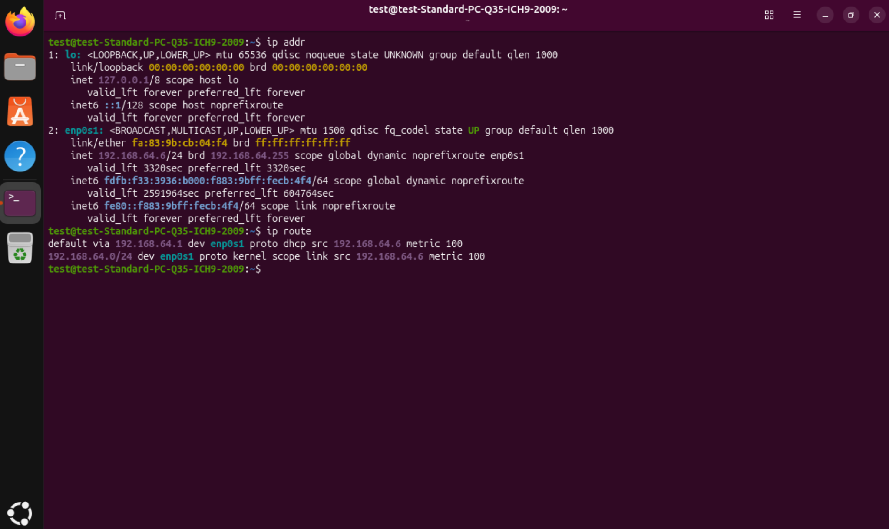
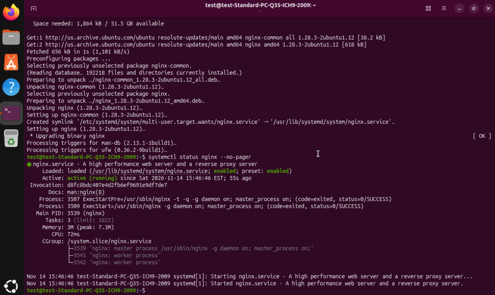
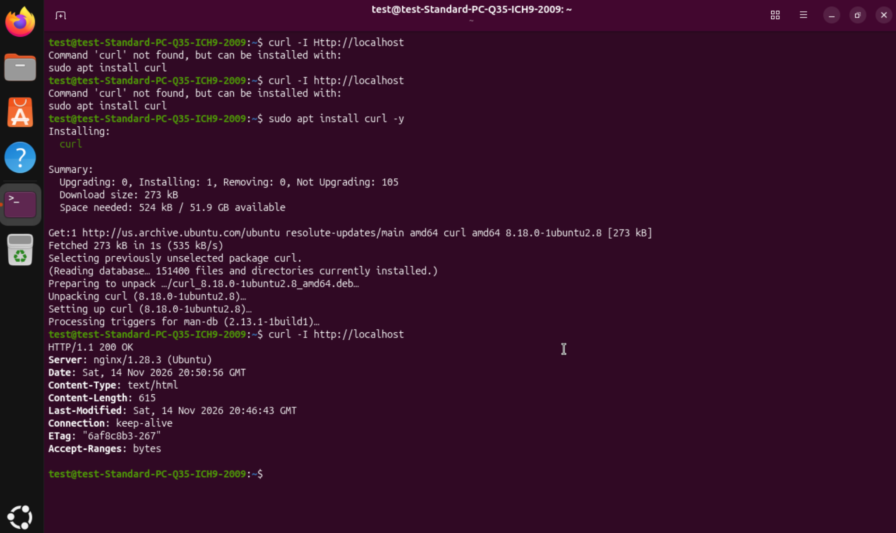
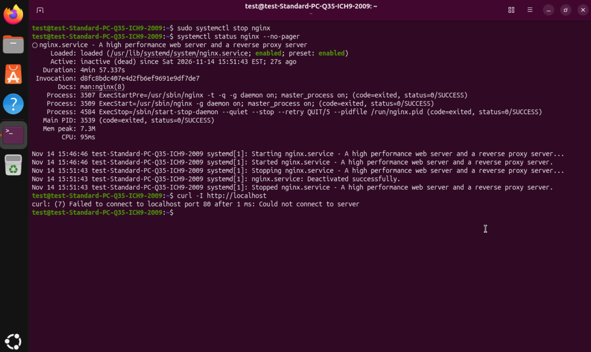
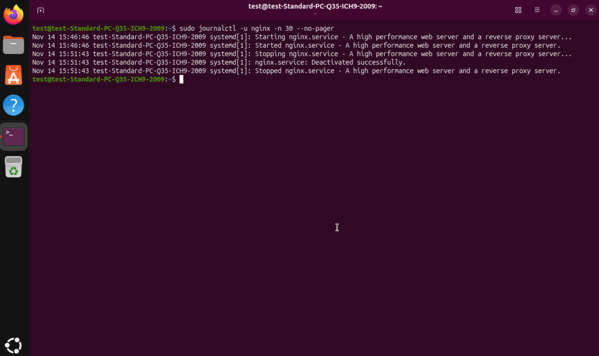
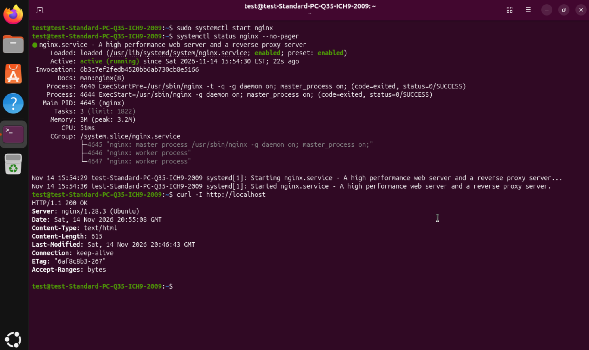
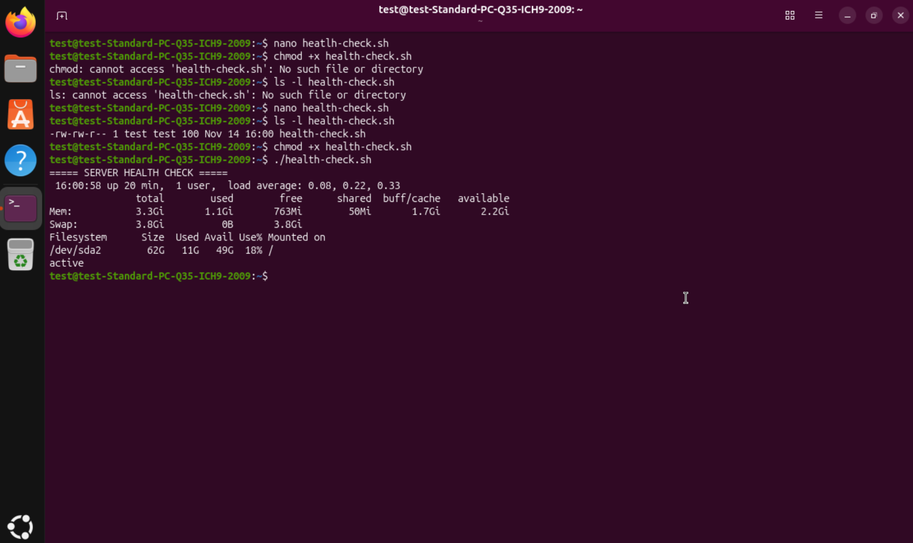

# Linux Server Administration & Incident Response Lab

  

## Overview
A hands-on **student-level Linux infrastructure administration** lab performed on November 14, 2026. I used an Ubuntu virtual machine to inspect server resources and networking, install and validate an Nginx web server, simulate and troubleshoot a controlled service outage, restore service, and create a Bash health-check script.

This is an **isolated training environment**, not a production deployment.

## Lab environment

| Component | Observed configuration |
| --- | --- |
| Host | MacBook with 16 GB RAM |
| Virtualization | UTM |
| Guest OS | Ubuntu 26.04.1 LTS (Resolute Raccoon) |
| Guest memory | 3.3 GiB total reported |
| CPU | 2 processing units available |
| Root filesystem | 62 GB; 11 GB used at initial inspection |
| Network interface | `enp0s1` (UP) |
| IPv4 / subnet | `192.168.64.6/24` (private lab address) |
| Default gateway | `192.168.64.1` |
| Web server | Nginx 1.28.3 (Ubuntu package) |

## Skills practiced
Linux command-line administration, package management, service lifecycle management with systemd, resource and network inspection, HTTP service validation, journal investigation, incident documentation, recovery validation, and basic Bash automation.

## Lab walkthrough and evidence

### 1. Identify the operating system
```bash
cat /etc/os-release
```
Identified Ubuntu 26.04.1 LTS. Knowing the distribution and release helps with package compatibility and troubleshooting.



### 2. Inspect system resources
```bash
free -h
nproc
df -h
```
Observed **3.3 GiB** total RAM, **2.3 GiB** available RAM, **2** available processing units, and **19%** root filesystem utilization at the initial check. These checks did not measure instantaneous CPU utilization.



### 3. Inspect network configuration
```bash
ip addr
ip route
```
Observed `enp0s1` in the UP state, `192.168.64.6/24`, and default route via `192.168.64.1`. Configuration alone does not prove external internet or DNS connectivity.



### 4. Install and check Nginx
```bash
sudo apt update
sudo apt install nginx -y
systemctl status nginx --no-pager
```
Installed Nginx 1.28.3 and confirmed the service was `active (running)` and enabled at startup.



### 5. Validate local HTTP response
```bash
sudo apt install curl -y
curl -I http://localhost
```
Initially, `curl` was unavailable. After installing it, the local web server returned **`HTTP/1.1 200 OK`**. The missing utility was a client-side tooling issue, not evidence of an Nginx failure.



### 6. Simulate a service outage
```bash
sudo systemctl stop nginx
systemctl status nginx --no-pager
curl -I http://localhost
```
Confirmed `inactive (dead)` and `curl: (7) Failed to connect to localhost port 80`. The OS remained accessible; only the web service was unavailable.



### 7. Investigate the service journal
```bash
sudo journalctl -u nginx -n 30 --no-pager
```
Reviewed startup and shutdown events. The logs showed Nginx was **deactivated successfully** at **15:51:43 EST**. The shutdown was intentional in this lab; the journal entries by themselves did not establish who initiated it.



### 8. Restore and validate service
```bash
sudo systemctl start nginx
systemctl status nginx --no-pager
curl -I http://localhost
```
Restarted Nginx at **15:54:30 EST**, verified `active (running)`, and received **`HTTP/1.1 200 OK`**.



### 9. Automate basic health checks
Created `health-check.sh` using Nano, saved it, set executable permissions, and ran it:
```bash
nano health-check.sh
ls -l health-check.sh
chmod +x health-check.sh
./health-check.sh
```
The script reports uptime, memory, root filesystem utilization, and Nginx service state. It reported **2.2 GiB available memory**, **18% root filesystem usage**, and **`active`** for Nginx. The first attempt to change permissions failed because the script had not been saved; saving and verifying the file resolved the issue.



Script source: [`scripts/health-check.sh`](scripts/health-check.sh). This is a manual status check, not continuous monitoring or alerting.

## Incident response case study
See the [controlled outage incident report](docs/incident-report.md) for the timeline, evidence, diagnosis, remediation, and validation.

**Troubleshooting approach:** Confirm symptoms → inspect service status → review journal → identify known cause → restore service → verify HTTP response → document findings.

## Lessons learned
- Server availability and application availability are separate concerns.
- Verify a service both at the process/service layer (`systemctl`) and the application layer (`curl`).
- System logs can establish a timeline without necessarily identifying the initiating actor.
- Small Bash scripts can standardize repetitive checks.
- Recording initial errors and their resolution makes lab documentation more useful.

## Potential next steps (not completed in this lab)
- Add thresholds, exit codes, and alerting to the script.
- Schedule checks with a systemd timer.
- Add SSH hardening, firewall rules, and patch management exercises.
- Repeat the scenario on an AWS EC2 instance with CloudWatch monitoring.

## Repository layout
```text
linux-server-administration-lab/
├── README.md
├── scripts/
│   └── health-check.sh
├── docs/
│   └── incident-report.md
└── screenshots/
    ├── 01-ubuntu-version.png
    ├── 02-system-resources.png
    ├── 03-network-configuration.png
    ├── 04-nginx-running.png
    ├── 05-http-response.png
    ├── 06-nginx-failure.png
    ├── 07-nginx-logs.png
    ├── 08-nginx-recovery.png
    └── 09-automation-script.png
```
